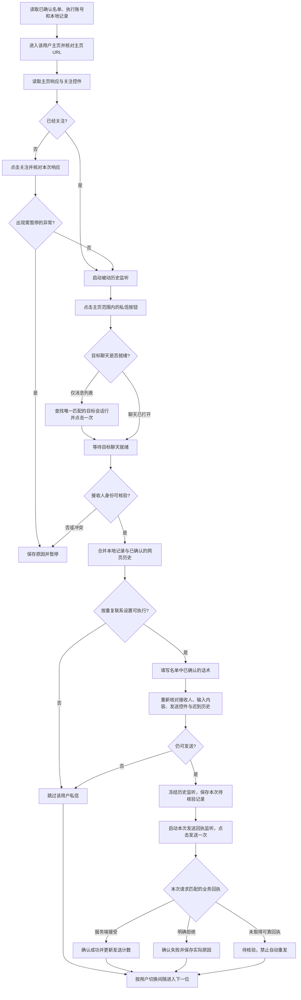
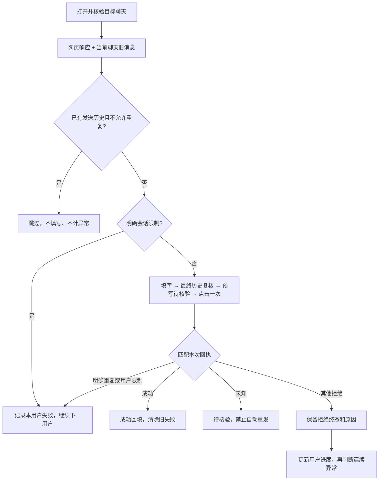

# 华贸获客：关注、私信流程与定向修复

更新：2026-10-10。交接范围：外部浏览器优先，关注、目标会话识别、历史防重、发送回执。

**对应版本：2.3.4。** 打包过程不覆盖当前安装目录；安装到原目录后生效，保留 API Key、账号登录资料、线索及联系记录。真实平台验收与 DOM 历史边界见第 7、8 节。2.3.4 按用户要求改为完整昵称核对，替换此前昵称加头像的规则。

## 1. 本次问题及结论

| 现象 | 已取得的证据 | 结论及处理 |
|---|---|---|
| 目标聊天已打开，仍报 `DM_RECIPIENT_UNCONFIRMED` | 主页 h1 中的 `✨` 是 `img alt="✨"`；聊天标题中是 Unicode 文字；头像资源标识相同 | 旧代码只读 `textContent`，漏掉图片表情。已修复完整昵称提取，并补充诊断 |
| 昵称全是表情 | 与上面相同的主页渲染方式会让旧提取结果变成空字符串 | 已支持图片表情还原，包括纯表情、组合表情；不把表情删除后匹配 |
| 旧消息可见，仍重复发送 | 截图中有昨天的消息，新消息有失败标记及达到发送上限提示 | 历史检测存在覆盖缺口；不能把新蓝色气泡视为发送成功 |
| 历史响应稍晚返回 | 原历史监听在初次短等待结束后即销毁 | 已保留监听到发送前，在准备发送及最终资格检查时读取最新结果；没有新增固定等待 |
| 网页直接显示缓存历史 | 已取得本人旧消息的真实 HTML，含三处 FromMe 标记及空状态栏 | 在已核验目标聊天中补充正向历史；不从空聊天推断从未私信 |
| 第三次拒绝后显示 2/8、该条变成待核验 | 3 次匹配回执均为 send=3；动作级暂停在结果返回前抛错，捕获分支又覆盖终态 | 保留同次终态，当前用户结果和进度落库后再按用户边界暂停 |
| 拒绝原因都显示“消息检查未通过” | 旧解析器跳过 check_code(5)、check_message(6) | 显示检查码，精确识别重复发送、会话上限和互关限制；未知码仍为通用拒绝 |
| 历史已发但本次重试被拒绝 | 已发历史和新失败是不同事实 | 列表同时显示历史已私信及最近失败；本次真正成功才清空失败原因并退出失败筛选 |

表情问题已经用用户提供的 DOM 结构复现，修复前报相同错误，修复后隔离页面通过。以上不能代替安装新版后对真实网页的验收。

## 2. 一个用户的完整流程



验证码、登录失效、授权失效、用户停止、目标身份冲突、连续异常等仍能中止流程。图中的“下一位”以任务仍允许继续为前提。

## 3. 每一步怎样实现

| 步骤 | 方法与边界 | 主要源码 |
|---|---|---|
| 固定名单 | 使用预检查确认的账号、用户、动作和话术；本地已发、待核验、重复间隔参与资格检查 | `engine-actions.js`、`workflow.js` |
| 进入主页 | 浏览器正常导航到目标 sec_uid 的主页；后续操作再次检查 URL 与目标一致 | `engine-actions.js`、`lib/outreach-browser.js` |
| 检查关注 | 被动读取当前主页关系响应，或读取目标主页“已关注／互相关注”控件；已关注则跳过点击 | `lib/profile-relation-observer.js`、`lib/outreach-browser.js` |
| 执行关注 | 原生浏览器点击；按本次请求及响应核验。仅按钮改变不等同于服务器确认 | `engine-actions.js`、关注响应监听 |
| 打开私信 | 只在当前主页用户信息及其关联操作区找私信按钮；排除全局顶部“消息”入口 | `lib/outreach-browser.js` |
| 进入会话 | 区分同时挂载的 list/chat 层；只有实际活动层可操作。列表存在不代表聊天已打开 | 同上 |
| 核对接收人 | 当前 StackLayout 只核对进入前主页完整昵称、当前主页昵称与活动聊天顶部昵称，不核对头像或聊天 UID | 同上 |
| 查历史 | 监听网页自己的历史请求与响应，匹配会话、发送者和目标；不主动重放私信接口 | `lib/dm-history-observer.js`、`lib/dm-protocol.js` |
| 填写 | 在已绑定的目标聊天输入框执行浏览器原生 fill，校验完整输入内容 | `lib/outreach-browser.js` |
| 发送前检查 | 重新检查名单资格、额度、停止状态、页面状态、迟到历史；适配器再次检查目标、输入框、内容和发送控件 | `engine-actions.js`、`lib/outreach-browser.js` |
| 点击发送 | 仅当前输入区内已激活的 `.e2e-send-msg-btn`；一次准备仅允许一次原生点击 | `lib/outreach-browser.js` |
| 发送结果 | 关联本次目标、消息、请求和协议回执；服务端接受、明确拒绝、未知分开保存 | `lib/dm-receipt-observer.js`、`lib/dm-protocol.js`、`workflow.js` |

## 4. 昵称含表情与纯表情的规则

1. 按 DOM 顺序读取文字与已识别 Twemoji 图片的 `alt`，将图片表情还原成 Unicode。
2. 对昵称作 NFC 与空白规范化。保留表情、肤色修饰符、组合表情的连接符和顺序；不删除表情，不使用只含汉字的模糊匹配。
3. 图片必须符合已观察到的资源格式，`alt` 必须与表情资源的码点一致。缺失或无法识别的图片使昵称证据不可用，不能退化成只匹配剩余文字。
4. `✨测试昵称✨` 与同样文字表情组合相匹配；与 `💎测试昵称💎` 不匹配。`💎` 这类纯表情昵称保留为完整昵称。
5. 当前聊天只核对完整昵称，头像缺失、地址格式不同或延迟加载均不阻止操作；不要求聊天 UID。昵称可能重名，列表出现多个同名候选时不自动选择。
6. 只读取当前活动聊天标题；消息列表预览不代替聊天对象。填写前和发送前仍复核昵称与输入内容；服务端回执继续按本次发送核验。

新版昵称诊断只记录 `chatNameCount`、`chatNameMatches` 和 `dom_profile_name` 依据，表示标题数量及完整昵称匹配结果。诊断不额外保存昵称、头像链接或聊天正文。

## 5. 历史防重与本次回执必须分开

### 历史观察

- 目前支持被动识别 `imapi.douyin.com/v1/message/get_by_conversation`（cmd301）与 `/v1/stranger/get_messages`（cmd1002）的对应二进制格式。
- 只接受当前页面发出的、可关联的请求和响应；校验参与者、会话、消息方向、服务端消息标识与已支持的状态字段。
- 看到可靠的本人历史文本可确认“曾发送”。只有满足完整范围及时间条件，才能用于自动重复联系间隔。
- 空响应或无法解析不等于从未发送。按用户已确定规则：没有本地已发／待核验记录且网页历史未知时，允许软件首发；不提醒或持久化未知历史标记。
- 本次调整：初次最多 1.5 秒等待结束后继续被动监听，直到发送前最后复核。监听总生命周期仍有 30 秒上限，最多识别 24 个候选请求；不增加动作间隔。
- 正向历史不会被后到的空页覆盖。相同观察不会因多次检查反复写入。
- 创建本次发送记录前关闭历史监听，防止本次发送之后的流量被混为先前历史。

### 重复联系资格

| 记录情况 | 行为 |
|---|---|
| 上次待核验 | 禁止自动重发 |
| 已有可靠发送记录，未开启重复 | 跳过 |
| 已开启重复，最近发送时间可靠且达到间隔 | 可继续，仍检查页面及本次权限 |
| 已有历史但最近时间未知 | 不自动重复 |
| 无本地已发记录，网页历史未知 | 按已确认策略允许软件首发 |

### 本次发送结果

`confirmed_success` 表示平台回执确认接受本次消息，不表示对方已读。

`confirmed_failure` 表示本次明确未执行或服务端明确拒绝；不自动扩展为对方永久禁止私信。

`pending_verification` 表示可能已发但未取得可靠结论，禁止自动重发。输入框清空、出现蓝色气泡、HTTP 200 均不能单独作为发送成功证明。

软件本地操作记录优先保留。网页手动发送历史被可靠识别后用于防重，不伪装成本次软件发送成功，也不增加本次额度计数。

## 6. 节奏与超时

同一个用户的关注、打开私信、填字、发送之间没有人为固定冷却。页面就绪和业务回执仍需等待，满足条件便立即继续。

- 不同用户之间：默认 10 秒、40% 抖动，约 6～14 秒，由当前有效设置决定。
- 私信控件就绪：通常最多 8 秒；实际选择了会话行后允许独立等待聊天挂载，整体最多 16 秒。该值是超时上限，不是每位用户必等时长。
- 发送回执：最多等待 30 秒，可靠回执到达即结束。
- 停止、权限和额度检查继续保留；本次修复不改采集、AI、数据表或默认设置。

## 7. DOM 历史补充和拒绝分类（2.3.3）

只在当前 URL、头像与完整昵称/明确 UID 核验通过的活动聊天层中检查 `.messageMessageListlist`。旧消息须同时具有 `messageMessageBoxisFromMe`、`MessageBoxContentisFromMe`、`MessageItemTextisFromMe`，以及当前已观察的 `msg-item-content`、纯文本结构。侧边状态栏与底部状态栏必须存在且为空；失败、发送中、未知装饰、对方消息、系统提示及会话列表摘要均不作为正向历史。

历史在聊天就绪、历史响应短等待结束、最终发送前再次读取，不增加固定操作间隔。发现历史且禁止重复时立即跳过；已有历史但最后时间不明仍不自动重复。旁边系统提示的“昨天 16:39”不能冒充消息的精确发送时间。DOM 不完整、未加载或结构变化时只返回未知，沿用既定的软件首发策略，不保存未知历史。

此观察记录为 `browser_chat_dom`，用于防重；不证明对方已读，不增加软件发送成功次数，不替代本次服务端回执。当前新发送仍关联 cmd=100、目标、请求序号、发送者及客户端消息 ID；status=0 且具有服务端消息 ID 才确认平台接受。

匹配本次请求后读取 `check_code` 和 `check_message`，只把明确的重复/会话上限/互关限制归为本用户拒绝，不增加连续异常计数，也不自动重试。原始 extra_info、鉴权和未知文本不落日志。无法识别的检查码没有猜测映射，保留通用拒绝及检查码；验证码、账号频繁、全局额度和不明连续拒绝仍暂停。网页提示只在目标聊天中、消息正文和输入框之外匹配，普通消息不能伪装成平台拒绝。

本次成功写回 `dmState/dmOutcome=confirmed_success`、清空 `dmFailedReason`、更新次数和时间，重新派生列表状态。旧失败标签不能覆盖新成功回执。仅发现旧消息时保留上次失败详情，展示“历史已私信 · 最近私信失败”，避免伪造本次成功。



## 8. 定向验证与后续发布计划

本轮仅运行与改动有关的测试，不调用真实抖音、不发送真实私信、不调用付费 AI、不改客户数据。

2.3.3 定向验收：源代码相关单元用例 **175 项通过**；实际混淆发布文件的关注私信执行用例 **64 项通过**；实际发布适配器的 DOM 历史和拒绝提示隔离浏览器用例 **11 项通过**。独立桌面启动、全新客户数据隔离、字段文档检查通过。此次没有重跑无关采集与 AI 全流程，也没有实网发送验收。

关键报告：`build-tools/v233-unit.log`、`v233-release-actions.log`、`v233-release-dom-verification.json`、`v233-desktop.log`。

发布物：`华贸获客-安装包-2.3.3.exe`（286,770,977 字节）与 `华贸获客-程序包-2.3.3.zip`。ZIP 和发布目录 573 个文件一致，未包含用户 data、浏览器资料或管理秘密。安装包 SHA256：`81028fb3083e3944ca54c8ed4fffdc6427839ea19e7b080b3b5633b4e256b190`。

为减少后续验证成本，同一套 `engine-actions.test.js` 支持设置 `OUTREACH_TEST_APP_DIR` 指向实际发布目录；默认仍测试源码。用制造页面对照真实脱敏结构测试浏览器定位，核心处理则用固定回执验证全部分支。新增拒绝文案时仅补充精确分类及相应回执用例，不根据陌生检查码猜测。

注意：2.3.2 已被覆盖成待核验的旧记录，不会仅凭“连续异常”文字自动改成失败；缺少原始同次回执时仍需人工核验。这与 2.3.3 修复后新任务能保留正确终态是两件事。

以下为此前 2.3.2 表情身份修复的验证记录：

| 检查 | 结果 |
|---|---|
| 修复前复现图片表情昵称 | 复现相同的 `DM_RECIPIENT_UNCONFIRMED` |
| 新增隔离浏览器用例 | 11 项通过：文字表情、纯表情、组合表情、列表选目标、错误表情、未知图片、头像差异、UID 冲突 |
| 原有主页身份定向用例 | 9 项通过：普通昵称、头像延迟、重复头像、身份变化及停止处理 |
| 历史监听与执行流程单元用例 | 72 项通过，包括迟到响应、停止、冻结、防重复、重复规则及原有流程 |
| 新增诊断输出定向用例 | 1 项通过，只保留允许的计数和匹配标志 |

从项目根目录运行定向命令：

```powershell
.\dy-lead-app\node.exe build-tools/verify-outreach-browser.js --source '--match=Emoji identity:'
.\dy-lead-app\node.exe --test --test-reporter=dot dy-lead-app/tests/dm-history.test.js dy-lead-app/tests/engine-actions.test.js
.\dy-lead-app\node.exe --test --test-reporter=spec '--test-name-pattern=身份依据诊断' dy-lead-app/tests/engine-actions.test.js
```

后续每次先复现故障并运行受影响模块；修复内容不再变化后统一执行全量回归、混淆产物浏览器测试、升级保留数据测试和安装包检查。最后核对安装路径、版本及发布产物，避免源码已修而客户端仍运行旧安装包。

真实发送验收应使用用户明确指定的测试对象与消息，并确认该次发送授权。当前合成页面测试仅证明代码分支及浏览器定位可工作，不宣称真实平台发送已经验收。

## 9. 2.3.4 本次误暂停与修改

蜗牛妈妈跨境创业中的主页与聊天昵称一致，头像均为 `be0c00128432b51fed9f`，旧版只允许 `/img/aweme-avatar/`，不识别 `/img/` 形式。隔离复现得到同样的 `profile_avatar_invalid` 和 `DM_RECIPIENT_UNCONFIRMED`。

按用户最终要求移除当前聊天的头像与 UID 校验，只保留完整昵称匹配。视觉省略号不截断 DOM 昵称；表情图片还原后比较。昵称就绪即继续，不等头像。当前网页自动从列表切换聊天时，识别已就绪聊天，避免多点列表造成超时。

本轮只运行受影响的昵称/聊天与历史测试，以及打包检查，不重复全程序回归，也不发送真实私信。原有历史防重、接收人级拒绝不计异常及成功状态回写逻辑保留。UID 与 sec_uid 为不同表示，当前提供的主页 HTML、聊天头 HTML 均没有可直接对照的双方 UID。
