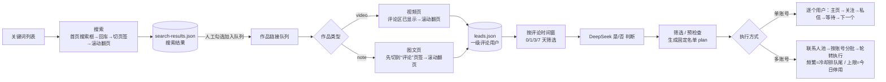
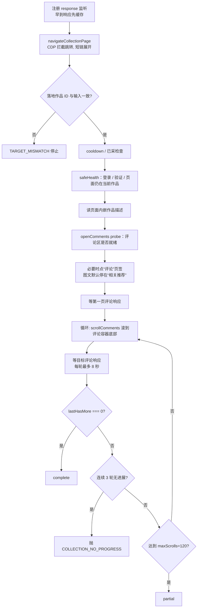
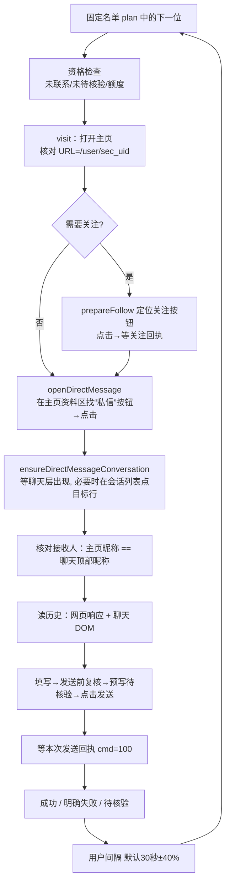

# 华贸获客（抖音获客）程序梳理与优化修复指南

- 编写日期：2026-10-20
- 对应代码：`main` 分支提交 `1b809f8`（版本 2.4.11）。文中行号都以这个提交为准，代码改动后请重新定位
- 读者：接手维护、排查和修复本程序的开发人员
- 初版只做梳理和诊断；同日已按本文完成修复，见文末「13. 修复记录（2026-10-20）」。所有修复均**未在真实抖音账号上实网验证**

> 证据等级标注（每个问题都会标一个）：
> - ✅ **代码确认**：读代码就能确定的逻辑缺陷，与平台行为无关
> - 🧪 **模拟复现**：把相关逻辑单独抽出来跑过，结果与描述一致
> - ❓ **推断**：代码上存在这种可能，需要用日志或实网现象确认后再修

---

## 目录

1. [业务流程总览](#1-业务流程总览)
2. [代码地图：哪段业务在哪个文件](#2-代码地图哪段业务在哪个文件)
3. [阶段一：关键词搜索](#3-阶段一关键词搜索)
4. [阶段二：作品评论采集（视频 / 图文）](#4-阶段二作品评论采集视频--图文)
5. [阶段三：按评论时间筛选 + AI 批量判断](#5-阶段三按评论时间筛选--ai-批量判断)
6. [阶段四：单账号关注 + 私信](#6-阶段四单账号关注--私信)
7. [阶段五：多账号私信分发](#7-阶段五多账号私信分发)
8. [横切问题：存储、性能、错误分级、节奏](#8-横切问题存储性能错误分级节奏)
9. [修复优先级路线图](#9-修复优先级路线图)
10. [排查手册：看日志定位问题](#10-排查手册看日志定位问题)
11. [仓库整理建议](#11-仓库整理建议)
12. [验证与回归方法](#12-验证与回归方法)

---

## 1. 业务流程总览



整条流水线是**一个进程内串行执行**的：后端 `server.js` 加载 `engine.js`，同一时刻只允许一个任务（`taskState.running` / `distributionActive`）。界面每 2.5 秒轮询一次 `/api/state` 拿进度。

各阶段的触发方式：

| 阶段 | 触发 | 接口 | 引擎入口 |
|---|---|---|---|
| 搜索 | 手动 | `POST /api/search/start` | `engine-search-tasks.js` `searchTask` |
| 采集 | 手动（搜索结果需人工勾选转队列） | `POST /api/collect/start` | `engine-collection-tasks.js` `collectTask` → `engine.js` `collectOne` |
| AI 判断 | 采集结束后自动（`collect.autoAiAfterCollect`，默认开）或手动 | `POST /api/ai/start` | `engine-ai-tasks.js` |
| 单账号触达 | 手动，需先预检查生成 plan | outreach 相关接口 | `engine-actions.js` `runTask` |
| 多账号分发 | 手动 | 分发相关接口 | `engine-dm-distribution.js` `dmDistributionTask`（每批内部复用 `runTask`） |

> 搜索 → 采集**目前没有自动串联**，需要人工在搜索结果里勾选加入采集队列（这是 `使用文档/设计方案/关键词搜索采集方案-2026-10-10.md` 第一阶段的有意设计）。

---

## 2. 代码地图：哪段业务在哪个文件

### 2.1 目录

| 目录 | 作用 | 备注 |
|---|---|---|
| `desktop/` | Electron 主进程、内嵌账号浏览器（`account-browser-host.js`） | |
| `dy-lead-app/` | 后端 + 网页工作台，**核心业务全部在这里** | 运行时依赖 `playwright-core`、`ws`（仓库不含 `node_modules`） |
| `dy-lead-app/lib/` | 页面内操作（序列化到浏览器执行的函数）、协议解析 | 发布时不参与混淆 |
| `dy-lead-app/web/` | 前端单页（`app.js` 约 15 万字节） | |
| `douyin-lead-ext/` | 早期浏览器插件版本 | 已不使用，见第 11 节 |
| `license-server/`、`license-admin-web/` | 授权服务与管理端 | 与获客流程无关 |
| `build-tools/` | 打包、发布门禁、大量一次性版本脚本 | 见第 11 节 |

### 2.2 核心文件与职责

| 业务 | 文件 | 关键函数 |
|---|---|---|
| 任务状态、浏览器启动 | `dy-lead-app/engine.js` | `setTask`、`launchAccount`(149)、`stopTask`(1140) |
| 节奏 / 停止 / 连续异常 | `dy-lead-app/scheduler.js` | `ActionScheduler.before/run/prepare/complete` |
| 搜索 | `dy-lead-app/engine-search-tasks.js`、`lib/search-works.js`、`lib/search-browser-actions.js` | `navigateSearch`、`parseSearchResponse` |
| 采集队列 | `dy-lead-app/engine-collection-tasks.js` | `collectTask` |
| 单作品采集 | `dy-lead-app/engine.js` | `collectOne`(564-1101) |
| 评论区定位 / 滚动 / 跳转 | `dy-lead-app/lib/collection-browser.js` | `openComments`、`scrollComments`、`navigateCollectionPage` |
| AI 判断 | `dy-lead-app/engine-ai-tasks.js`、`ai.js`、`lead-query.js` | `filterLeads`（评论时间窗在 `lead-query.js:98`） |
| 关注 / 私信流程 | `dy-lead-app/engine-actions.js` | `visit`、`followOne`、`dmOne`、`runTask` |
| 关注 / 私信页面操作 | `dy-lead-app/lib/outreach-browser.js` | `inspectControls`、`openDirectMessage`、`ensureDirectMessageConversation` |
| 私信回执 / 历史 | `lib/action-receipts.js`、`lib/dm-protocol.js`、`lib/dm-history-observer.js` | |
| 多账号分发 | `dy-lead-app/engine-dm-distribution.js`、`lib/dm-account-signals.js` | `allocateLeads`、`dmDistributionTask`、`classifyAccountSignal` |
| 资格判断（能不能关注 / 私信） | `dy-lead-app/workflow.js` | `eligibility`、`contactKey`、`uniqueContacts` |
| 存储 | `dy-lead-app/store.js` | `readJson` / `writeJson`（全量同步读写） |
| HTTP 接口 | `dy-lead-app/server.js` | `/api/state`(243) |

### 2.3 数据文件（`data/` 目录，均为 JSON）

| 文件 | 内容 | 写入时机 |
|---|---|---|
| `leads.json` | 所有评论用户线索（代码注释提到实际规模约 1.7 万条） | 每收到一页评论、每次关注 / 私信状态变化 |
| `videos.json` | 作品详情与采集状态（`collectionState`: complete / partial / interrupted） | 详情响应、作品结束 |
| `search-results.json` | 搜索结果 | 每个关键词结束 |
| `daily.json` | 每账号每运营日用量（8 点切日） | 每次动作 |
| `plans.json` | 预检查生成的固定名单 | 预检查 |
| `dm-account-state.json` | 多账号的频繁冷却 / 今日停用状态 | 分发过程 |
| `contact-allocation.json` | 分发分配锁（6 小时 TTL） | 分发过程 |
| `task-checkpoint.json` | 当前任务断点 | 频繁 |

---

## 3. 阶段一：关键词搜索

### 3.1 现状流程（`engine-search-tasks.js`）

1. 每个关键词都 `page.goto('https://www.douyin.com/')` 打开首页，固定等 2.5 秒
2. 找搜索框 → 鼠标点击 → 逐字输入 → 回车；没跳转再点搜索按钮
3. 按范围点击“视频 / 图文”页签（`clickSearchTab`），固定等 2 秒
4. 被动监听 `/aweme/v1/web/(general/)search/(single|item)/` 响应，解析作品放进 `worksBuffer`
5. 循环滚动最多 `maxPages` 页，每页最多等 8 秒新响应
6. 按最少评论数过滤后写入 `search-results.json`，等关键词间隔（默认 60 秒 ±20%）

### 3.2 问题清单

| # | 问题 | 位置 | 等级 | 影响 |
|---|---|---|---|---|
| S1 | 点击页签前“综合”页已返回的结果留在 `worksBuffer` 里，切页签后没有清空；页签是否切换成功也不检查（返回值被 `.catch` 吞掉） | `engine-search-tasks.js:61-65`、`lib/search-browser-actions.js:34` | ✅ | 选“视频”时混入图文 / 综合结果，`hasMore` 也可能是综合页的 |
| S2 | `clickSearchTab` 点击页面上**第一个**文字等于“视频”的 div/span/a，可能点到顶部导航或别的区域 | `lib/search-browser-actions.js:34-38` | ❓ | 页签切换不可靠 |
| S3 | 一页 8 秒内没收到新响应，且已有数据，就直接结束整个关键词 | `engine-search-tasks.js:200` | ✅ | 网络稍慢就提前结束，翻页数明显少于设定 |
| S4 | `scrollSearchFeed` 滚动“可滚动量最大”的容器，不保证是结果列表 | `lib/search-browser-actions.js:44-60` | ❓ | 可能滚错容器导致不翻页（日志只在第 1 页记录容器名） |
| S5 | 大量固定 `sleep`（2500/1200/500/400/2000ms）而不是等条件 | `engine-search-tasks.js:29-66` | ✅ | 慢且不稳 |
| S6 | `searchUrl()` 定义了但没被使用 | `engine-search-tasks.js:20` | ✅ | 死代码 |
| S7 | `/api/search/clear` 只检查 `taskState.running`，分发任务批次之间 `running=false` 时也能清空 | `server.js:386` | ✅ | 小问题 |

### 3.3 修复建议

- **S1**：点击页签后先确认切换成功（URL 含 `type=video` / `type=note`，或页签带 `aria-selected="true"`），确认后再 `worksBuffer.length = 0; hasMore = false;`，然后等新响应。入库前再按 `work.workType === opts.workType` 过滤一次（综合模式除外）。
- **S2**：页签定位优先用 `[role="tab"]`，并限定在搜索结果区域内；找不到就记录日志并按“综合”结果处理，不要静默点任意元素。
- **S3**：改为“连续 2 页无新响应”才结束；同时识别结果列表底部的“没有更多”文案（以实际页面文案为准）作为结束依据。
- **S5**：用 `page.waitForURL(/\/search\//)`、`page.waitForResponse(SEARCH_PATH)` 替代固定等待，超时仍保留。
- 可选（第二阶段）：搜索结果按“评论数阈值 + 未采集过”自动加入采集队列，做成“先搜索后采集”串联任务，保留人工确认开关。

---

## 4. 阶段二：作品评论采集（视频 / 图文）

### 4.1 现状流程（`engine.js` `collectOne`）



**完成判定只认一件事：采纳的评论接口响应里 `has_more = 0`**（`engine.js:1082`）。

评论响应处理（`engine.js:614-756`）：

- 只收 `aweme_id` 等于目标作品的 `/aweme/v1/web/comment/list/`
- 按请求参数（`pc_img_format`、是否带 `insert_ids`、`sort_type`、`comment_type`、`item_type`）把响应分成多个“分页来源”（图文页会同时翻“定位评论列表”和“普通列表”）
- 用全局 `highestRequestCursor` 判断“过期页”（stalePage），过期页**不能**更新 `lastHasMore`
- 只保存一级评论（`level === 1`）；去重键 = 账号 + 作品 ID + 用户 + 评论文本

### 4.2 已知问题①：图文评论已经翻到底，程序却认为还没翻完

**根因（✅ 代码确认 + 🧪 模拟复现）**：`has_more=0` 是否被采纳，用的是**跨所有分页来源的全局游标**判断，而不是本来源自己的游标。

`engine.js:668-669`：

```js
const stalePage = requestCursor !== null && highestRequestCursor !== null && requestCursor < highestRequestCursor
  || !newerRequest && cursor !== null && highestCursor !== null && cursor < highestCursor;
```

`engine.js:686-687`：只有 `!stalePage` 才更新 `lastHasMore`。

图文页上，“定位评论列表”（带 `insert_ids`）和“普通评论列表”会各自翻页。只要定位列表的游标先走得更深，普通列表最后一页（请求游标更小）就会被当作“过期页”，它的 `has_more=0` 被丢掉。同时 `engine.js:681` 又把这页的进展置为 false，于是：

- 滚动返回 `at_end`（评论区已经滚到底）
- 没有新响应、也没有“进展”
- 连续 3 轮后抛出 `COLLECTION_NO_PROGRESS`（“连续 3 轮未取得目标评论分页进展”），作品被记为 `interrupted`

模拟（复刻 661-693 行判定逻辑）：

```
A(insert_ids) req=0  ret=20 has_more=1 -> stalePage=false lastHasMore=1
A(insert_ids) req=20 ret=40 has_more=1 -> stalePage=false lastHasMore=1
B(普通)       req=0  ret=20 has_more=1 -> stalePage=true  lastHasMore=1
B(普通)       req=20 ret=30 has_more=0 -> stalePage=true  lastHasMore=1   ← 到底信号被丢弃
```

**连带问题**：

| # | 问题 | 位置 | 等级 |
|---|---|---|---|
| C1 | 上面这个全局游标判定（核心） | `engine.js:661-693` | ✅🧪 |
| C2 | 页面 DOM 已显示“到底”时，程序不用它做任何辅助判断；`scrollComments` 只返回 `scrolled/at_end/not_ready` | `lib/collection-browser.js:71-127` | ✅ |
| C3 | 单个作品抛 `TaskStopError`（无进展、评论区找不到、响应超时）会**中止整个采集队列**，后面的作品都不采了 | `engine-collection-tasks.js:83` 没有 try/catch | ✅ |
| C4 | 被误判为 `interrupted` 的作品不受重采冷却保护（`partial/interrupted` 直接跳过冷却），每次都重新采，浪费额度并增加风控暴露 | `engine-collection-tasks.js:64` | ✅ |
| C5 | 最后一页 `comments: null` 但缺 `cursor` 字段时，会被判为“评论字段格式无效”拒收（`nullTerminal` 要求 cursor 和请求 cursor 都存在） | `engine.js:635-644` | ❓ 需看日志是否出现“评论字段格式无效” |
| C6 | `scrollComments` 往上找可滚动祖先时，遇到包含推荐列表的祖先就停止，返回 `not_ready`，某些布局下永远滚不动 | `lib/collection-browser.js:112-126` | ❓ |
| C7 | 只采一级评论，二级回复里的潜在客户全部丢失 | `engine.js:701` | 业务取舍 |
| C8 | 每收到一页评论就整文件读写 `leads.json`、`videos.json` | `engine.js:694-751` | ✅ 见第 8 节 |

### 4.3 修复方案

**C1（必须修）**：完成判定改成“按来源独立记录 has_more”，过期判断也只在同一来源内比较。

```js
// engine.js 约 670 行附近：每个来源独立记录最后一次 has_more
const hasMoreValue = [0, 1, '0', '1'].includes(j.has_more) ? Number(j.has_more) : null;
if (!staleSourcePage && hasMoreValue !== null) source.lastHasMore = hasMoreValue;

// 681 行：只用本来源的过期判断决定是否算进展
if (staleSourcePage && hasMoreValue !== 1) advanced = false;

// 686 行替换为：主列表（不带 insert_ids 的来源）到底，或所有来源都到底，即视为完成
const entries = [...paginationSources.entries()];
const primaryDone = entries.some(([key, s]) => JSON.parse(key)[1] === false && s.lastHasMore === 0);
const allDone = entries.length > 0 && entries.every(([, s]) => s.lastHasMore === 0);
if (primaryDone || allDone) lastHasMore = 0;
else if (!stalePage && hasMoreValue !== null) lastHasMore = hasMoreValue;
```

> 注意：`sourceKey` 是 `JSON.stringify([pc_img_format, has(insert_ids), sort_type, comment_type, item_type])`，下标 1 是“是否带 insert_ids”。修改后要补一个测试：两来源交错、普通列表在较小游标处 `has_more=0`，期望 `complete`。

**C2（建议）**：在 `scrollComments` 里识别评论区底部的结束提示（例如“暂时没有更多评论”，**以实际页面文案为准，先在账号浏览器里确认**），返回 `state: 'dom_end'`。在主循环里：`at_end` + `dom_end` + 没有待处理的评论响应，连续 2 轮 → 记为完成，但 `collectionReason` 写明“页面显示到底，接口未给 has_more=0”，状态可用 `complete_dom` 区分，方便以后统计。

**C3（必须修）**：`collectTask` 循环里给 `collectOne` 包一层错误分级：

| 错误码 | 处理 |
|---|---|
| `LOGIN_*`、`PLATFORM_VERIFICATION`、`PLATFORM_RESTRICTED`、`AUTH_REQUIRED`、`PAGE_CLOSED`、`TASK_STOPPED` | 账号 / 任务级：停止整个队列（保持现状） |
| `COLLECTION_NO_PROGRESS`、`COMMENT_PANEL_NOT_FOUND`、`COMMENT_RESPONSE_MISSING`、`TARGET_MISMATCH`、`INVALID_VIDEO_LINK` | 作品级：记 `interrupted` + 原因，跳到下一个作品；连续 N 个作品级失败再停 |

**C4**：修完 C1 后，大部分误判的作品会变成 `complete`；另外建议给 `interrupted` 也加一个短冷却（比如 2 小时），避免同一坏作品反复打开。

**C5 / C6**：先查日志（第 10 节），确认出现过再修；修法分别是“末页允许缺 cursor，只要 `has_more=0` 且 HTTP 与 `status_code` 正常”和“推荐列表判断只排除推荐列表本身，不阻止继续向上找滚动容器”。

---

## 5. 阶段三：按评论时间筛选 + AI 批量判断

### 5.1 现状

- 采集结束后，如果开启了自动判断，只判断**本次采集到的**评论用户，时间窗默认 7 天（`ai.autoJudgeWindowDays` ∈ {0,1,3,7}，0 = 全部）——`engine-collection-tasks.js:122-125`
- 时间窗过滤在 `lead-query.js:98-100`：**没有评论时间戳的线索直接被排除**
- 判断结果按规则版本缓存，`AI.isCurrentResult` 判断是否需要重判

### 5.2 问题

| # | 问题 | 位置 | 等级 | 影响 |
|---|---|---|---|---|
| A1 | AI 只判断时间窗内的线索，但进度统计 `aiProgress()` 用的是**本次全部**评论用户。超出时间窗的永远“待判断”，所以只要采到过 7 天前的评论，采集汇总就显示“AI判断暂停：还有 N 条待判断” | `engine-collection-tasks.js:31-38, 126-128` | ✅ | 每次都像是失败，用户无法区分真失败和正常跳过 |
| A2 | 没有时间戳的评论被时间窗静默排除，界面不提示 | `lead-query.js:100` | ✅ | 漏判 |

### 5.3 修复

- **A1**：`aiProgress` 用与 `runAi` 相同的过滤条件（`filterLeads(..., { commentDays: windowDays })`）计算待判断数；另外单独统计并展示“超出时间窗未判断 X 条 / 缺评论时间 Y 条”。`successful` 只看时间窗内是否全部完成。
- **A2**：在汇总里显示缺时间戳数量；是否纳入判断做成设置项。

---

## 6. 阶段四：单账号关注 + 私信

### 6.1 现状流程（`engine-actions.js` `runTask`，每个用户一次主页访问）



页面操作的定位规则在 `lib/outreach-browser.js` 的 `inspectControls`：

- 私信入口：只在主页资料区（`[data-e2e="user-info"]` 或与关注按钮 `[data-e2e="user-info-follow-btn"]` 成对的兄弟区域）里找文字为“私信 / 发私信 / 发送私信 / 发消息 / 发送消息”的按钮，最多等 8 秒（`WAIT_MS`）
- 点击：Playwright `handle.click({ timeout: 2000 })`（`CLICK_MS`）
- 聊天就绪：`[data-e2e="im-dialog"] [data-stack-layer="chat"]` 且标题栏中心点 `elementFromPoint` 命中，最多 16 秒
- 接收人确认：主页 `h1` 昵称（图片表情还原成 Unicode）必须与聊天标题 `.StackLayoutStackChatHeadertitle` 完全一致

### 6.2 已知问题②：私信时有的能进入私信页面，有的没反应

“没反应”在代码里对应几条不同的失败路径。下面按“用户看到的现象”分类，每条都给出日志里能看到的错误码（日志格式见第 10 节）。

| # | 现象 | 代码路径 | 日志里的 code | 等级 |
|---|---|---|---|---|
| D1 | 私信按钮被遮挡 / 正在动画中，点击 2 秒超时，**没点上**；错误被当作普通异常，直接进入下一个用户 | `outreach-browser.js:615` `handle.click({timeout: 2000})` 抛 `TimeoutError`，`openDirectMessage` 不捕获；`engine-actions.js:35` `stopClassError` 对无 code 的错误原样返回，最终只记“线索处理异常” | 无 code，日志为 `线索处理异常：昵称（... Timeout 2000ms exceeded ...）` | ✅ 路径确认 / ❓ 遮挡来源待确认 |
| D2 | 主页上找不到私信按钮（对方关闭陌生人私信、企业号按钮文案不同、窄窗口时私信被收进“…”菜单、关注后弹出的推荐面板改变了布局） | `inspectControls` kind=`open`，`outreach-browser.js:224-240` | `DM_ENTRY_NOT_FOUND` / `DM_ENTRY_UNAVAILABLE` | ❓ |
| D3 | 关注成功后关注按钮变成“已关注”，`[data-e2e="user-info-follow-btn"]` 数量变化（不再是唯一 1 个），私信按钮与资料区的“配对”失败，于是找不到入口。**这会导致“先关注再私信的用户失败、本来就已关注的用户成功”这种看起来随机的差异** | `pairedSiblingProfile`，`outreach-browser.js:145-153` | `DM_ENTRY_NOT_FOUND`，诊断里 `profileControlCount` 为 0 | ❓ 强烈建议优先核对 |
| D4 | 点了私信，抽屉打开了，但昵称核对不上，程序不填字（看起来像“进去了但没反应”） | `displayName` 遇到任何非 Twemoji 的 `IMG` 或 `SVG`（如认证标、等级图标）直接返回 null → 整个昵称为空；或对方被设置了备注名，聊天标题显示备注 | `DM_RECIPIENT_UNCONFIRMED`，诊断 `profileIdentityReason: profile_name_empty` 或 `chatNameMatches: 0` | ✅ 代码确认（SVG/IMG 即判空）/ ❓ 实际页面是否有这类图标待确认 |
| D5 | 点了私信，只出现消息列表，没有目标会话（从未聊过的用户列表里没有这一行），等满 16 秒失败 | `selectTargetConversation`，`outreach-browser.js:626-667` | `DM_MESSAGE_LIST_ONLY` / `DM_TARGET_CHAT_NOT_READY` | ❓ |
| D6 | 聊天层标题栏中心被 toast / 提示浮层盖住，`elementFromPoint` 命中失败，被判为“聊天未就绪” | `activeStackLayer`，`outreach-browser.js:245-255` | `DM_TARGET_CHAT_NOT_READY` | ❓ |
| D7 | 事件循环被大文件读写阻塞，页面等待和 2 秒点击超时更容易触发（见第 8 节 X1、X2） | `store.js` 全量同步读写 + `/api/state` 每 2.5 秒全量计算 | 各种超时 | ❓ 数据量大时概率高 |

**放大效应（✅ 代码确认）**：

- `DM_RECIPIENT_UNCONFIRMED`、`DM_COMPOSER_CHANGED` 等码在 `stopClassError`（`engine-actions.js:35`）里被升级为 `TaskStopError`：**一个用户昵称对不上，单账号任务整个暂停**；在多账号分发里，这个账号会被判“异常”，本次分发不再使用（见 7.2 M4）。
- 入口找不到（D2/D3）记为 anomaly，连续 3 个（`human.maxConsecutiveErrors` 默认 3）就整体暂停。

### 6.3 修复方案

**第一步：先用日志确认是哪一类**（第 10 节有 grep 命令）。不同类别修法不同，不要一次全改。

**D1（必须修）**：

```js
// outreach-browser.js openDirectMessage，替换 615 行附近
try {
  await handle.scrollIntoViewIfNeeded({ timeout: CLICK_MS });
  await handle.click({ timeout: 5000 });
} catch (error) {
  if (error.name !== 'TimeoutError') throw error;
  // 记录是谁挡住了按钮（只记 class/data-e2e，不记文本），便于后续针对性处理
  const blocker = await handle.evaluate(el => {
    const r = el.getBoundingClientRect();
    const hit = document.elementFromPoint(r.left + r.width / 2, r.top + r.height / 2);
    return hit && !el.contains(hit) ? `${hit.tagName}.${String(hit.className).slice(0, 60)}|${hit.getAttribute('data-e2e') || ''}` : '';
  }).catch(() => '');
  return remember(page, { code: 'DM_ENTRY_CLICK_BLOCKED', diagnostic: { blocker } });
}
```

并在 `engine-actions.js` 的 `dmPreparationError.messages` 里加上 `DM_ENTRY_CLICK_BLOCKED` 的中文说明。点击后再检查 `[data-e2e="im-dialog"]` 是否出现：**没出现说明点击无效**（区别于“抽屉开了但没核对上”），这种情况允许按 Esc 关闭浮层后再点一次入口（只限入口按钮，会话行和发送按钮仍保持“只点一次”的原则）。

**D2**：

- 入口文案增加企业号常见文案前先到真实页面确认，不要猜
- 处理“…”更多菜单：在资料区找唯一的更多按钮，展开后在弹出菜单里按同样规则找“私信”
- 固定账号浏览器视口宽度（外部 Chrome 已是 1280×860；**内嵌浏览器尺寸跟随窗口，需要设最小宽度**）

**D3**：`pairedSiblingProfile` 的“唯一一个关注按钮”条件，改为同时接受“已关注 / 互相关注”状态下的按钮标记；或者在关注成功后重新加载一次主页（成本是多一次主页访问，需要权衡额度）。修之前先用日志确认：同一批里“新关注后私信失败”的比例是否明显高于“已关注直接私信”。

**D4**：`displayName` 中，对位于昵称文字外层的装饰性 `SVG` / 非表情 `IMG` 改为忽略而不是让整个昵称失效；只有表情图片识别失败才返回 null。同时把 `DM_RECIPIENT_UNCONFIRMED` 从“整任务暂停”降为“本用户失败、跳过”（见下一条）。

**错误分级（必须修）**：把私信相关错误分成三级，统一在一个地方定义，代替 `stopClassError` 里的正则：

| 级别 | 码 | 处理 |
|---|---|---|
| 任务级 | `TASK_STOPPED`、`AUTH_*`、`PLAN_CHANGED`、`PLAN_IDENTITY_CHANGED` | 停止整个任务 |
| 账号级 | `LOGIN_*`、`PLATFORM_VERIFICATION`、`PLATFORM_RESTRICTED`、`PLATFORM_DAILY_LIMIT`、`PAGE_CLOSED`、`SESSION_*` | 单账号：暂停；多账号：按频繁 / 上限 / 异常处理该账号 |
| 用户级 | 所有 `DM_ENTRY_*`、`DM_RECIPIENT_*`、`DM_TARGET_CHAT_NOT_READY`、`DM_EDITOR_*`、`DM_SEND_*`、`TARGET_MISMATCH`、`FOLLOW_*` | 记本用户失败原因，继续下一位；连续 N 个用户级失败才升级为账号级 |

> 注意：`DM_RECIPIENT_MISMATCH`（聊天对象明确是别人）属于身份冲突，保持“立即暂停”是对的，不要降级。

---

## 7. 阶段五：多账号私信分发

### 7.1 现状流程（`engine-dm-distribution.js`）

1. 清掉上一轮未消费的分配锁
2. `candidates()`：按筛选条件取线索，关注或私信任一可做就入池，按 `业务ID|uid` 去重，按评论时间倒序
3. `allocateLeads()`：按账号剩余额度（主页访问 / 关注 / 私信 / 经验上限）和“同一视频错峰”分配到各账号 `blocks`
4. 轮转：每轮每个账号执行一批（`batchPerAccount` 默认 5），批之间等账号切换间隔（默认 90 秒 ±30%）；每批内部就是一次单账号 `runTask`
5. 批结果：
   - 成功 → 消费分配锁
   - `daily_limit` → 账号今日停用到次日 8 点，本批回池
   - `frequent` → 冷却（默认 1800 秒，逐次翻倍，封顶 2 小时），超过每日次数（默认 2）今日停用，本批回池
   - 其他异常 → 本次分发内不再使用该账号，本批回池
6. 每轮结束，如有回池用户就重新分配；某轮没有任何账号执行就结束；最多 30 轮

### 7.2 问题清单

| # | 问题 | 位置 | 等级 | 影响 |
|---|---|---|---|---|
| M1 | **只要有一批回池，本轮结束时 `blocks = next.blocks` 直接覆盖，所有账号手里还没执行的用户全部丢失**（分配锁也残留为未消费） | `engine-dm-distribution.js:312-314` | ✅ | 分发提前“完成”，汇总里“待分配 0”，大量用户实际没联系。**这是目前最严重的问题** |
| M2 | 账号频繁冷却 / 今日停用后，只有当前这一批回池，它 `blocks` 里剩下的用户不回池（随后又被 M1 丢掉） | `engine-dm-distribution.js:241-253, 282-295` | ✅ | 与你要求的“频繁 → 切换账号，账号排到队尾”不一致 |
| M3 | 所有账号都在**频繁冷却**时（冷却可能只有几十分钟），这一轮 `progressed=false` 直接结束任务，不等冷却结束 | `engine-dm-distribution.js:311` | ✅ | “往后重新排队”实际变成“结束” |
| M4 | 账号信号分类过宽：`/稍后再试/`、`/检查码/`、`/消息检查未通过/` 都算“频繁”；“接收人级”信号（recipient）和无法分类（null）都会落到 else 分支，把**整个账号判为异常**；连续 3 个用户找不到私信入口也会让账号整轮作废 | `lib/dm-account-signals.js:9-42`、`engine-dm-distribution.js:296-305` | ✅ | 一个特殊用户就能让一个账号整轮停用，账号被误判频繁冷却 |
| M5 | 批次中途遇到频繁 / 上限时，`runTask` 返回 `ok:false`，本批**已经成功**的关注 / 私信数不计入汇总；整批（含已处理用户）回池 | `engine-dm-distribution.js:268-305` | ✅ | 统计偏少；已处理用户回池后靠 `runTask` 资格检查跳过（不会重复发，但会被记为“跳过”，`summary.done` 偏大） |
| M6 | 每批新建一个 scheduler，“每成功 5 条强制休息”的计数和截止时间随批次丢失。默认 `sessionPause.count=5` 与 `batchPerAccount=5` 相同，第 5 条成功后设置的休息**永远不会生效** | `engine-actions.js:553`、`scheduler.js:31-41` | ✅ | 账号节奏比设置的更激进，增加频繁风险 |
| M7 | 最多 30 轮的硬上限，达到后静默结束 | `engine-dm-distribution.js:233` | ✅ | 大名单跑不完且没有提示 |
| M8 | 每批都 `launchAccount(..., {headless:false})`，执行过的账号浏览器都不关闭 | `engine-actions.js:555`、`engine.js:149` | ✅ | 账号多时内存压力大 |
| M9 | 分配时只看当天已用量，不扣除“已分到 blocks 但未执行”的数量；M1 修好后重新分配会超额 | `allocateLeads`，`engine-dm-distribution.js:107-155` | ✅ | 修 M1 时必须一起处理 |

### 7.3 修复方案

**M1 + M2 + M9（必须一起修）**：回池时把不可用账号手里的剩余用户一起收回；重新分配时**合并**而不是覆盖，并把已预留数量传给分配函数。

```js
// 每轮结束（替换 engine-dm-distribution.js:311-321）
if (!progressed && !(await waitForCooldownIfAny())) break;   // M3，见下
const now = Date.now();
for (const item of pool) {
  const id = String(item.accountId);
  if (unhealthy.has(id) || blocked(state, id, now).blocked) {
    unassigned.push(...(blocks[id] || []));      // M2：收回不可用账号的剩余用户
    for (const lead of blocks[id] || []) delete allocations[workflow.contactKey(lead, settings)];
    blocks[id] = [];
  }
}
if (unassigned.length) {
  const reserved = Object.fromEntries(Object.entries(blocks).map(([id, list]) => [id, list.length]));
  const next = allocateNow(reserved);            // M9：allocateLeads 先扣掉 reserved
  for (const [id, list] of Object.entries(next.blocks)) blocks[id] = [...(blocks[id] || []), ...list];  // M1：合并
  unassigned = next.leftovers;
}
```

**M3**：没有账号可执行时，区分原因：

- 还有账号处于 `frequent` 冷却 → 等到最早的 `frequentUntil`（等待中可随时停止、界面显示倒计时），然后继续下一轮
- 所有账号都是今日停用 / 异常 → 结束，提示“剩余 N 人待明日 8 点后继续”

**M4**：

- `classifyAccountSignal` 先判 recipient，再判 frequent；去掉 `/稍后再试/` 这类泛化文案；`/检查码/` 只在检查码属于账号级时才算频繁（`lib/dm-rejection.js` 已经有精确分类，复用它）
- 分发里的 else 分支只处理真正的账号级错误码（`LOGIN_*`、`PAGE_CLOSED`、`PLATFORM_VERIFICATION` 等）；`recipient` / `null` / 用户级 `CONSECUTIVE_ERRORS` 不应作废账号，最多让该账号“本轮跳过”
- 配合第 6.3 节的错误分级

**M5**：`runTask` 返回时带上 `processedLeadIds`（已有 `doneIds`）；分发里不论 `ok` 与否都累加计数，只把**未处理**的用户回池。

**M6**：把“距离上次强制休息后已成功条数”和“休息截止时间”存进 `dm-account-state.json` 的账号条目里，scheduler 创建时读入、`afterDmSent` 时写回。

**M7**：达到轮数上限时写日志并在汇总里显示原因；或者改为“没有进展才停”，去掉固定 30。

**M8**：轮到下一个账号前，关闭上一个账号的浏览器（可做成设置项，默认关闭）。

---

## 8. 横切问题：存储、性能、错误分级、节奏

| # | 问题 | 位置 | 等级 | 影响 |
|---|---|---|---|---|
| X1 | `store.js` 没有内存缓存：每次 `getLeads()` 都从磁盘同步读取并 `JSON.parse` 整个 `leads.json`，每次 `setLeads()` 都同步写整个文件（带缩进）。触达流程里每个用户会调用 `latest()` / `can()` 几十次 | `store.js:34-48, 150-151`、`engine-actions.js:37-38` | ✅ | 1.7 万条线索时每次读写都是几十 MB 级的同步操作，**阻塞事件循环**；Playwright 在同一进程，所有超时都会受影响 |
| X2 | `/api/state` 每 2.5 秒被界面轮询，每次读取全部线索、作品、设置，逐条计算 AI 状态，并把整个 `videos` 返回给前端 | `server.js:243-256`、`web/app.js:2129` | ✅ | 同上；任务越跑数据越多越慢 |
| X3 | 错误分级靠错误码正则 + 中文文案匹配，分散在 `stopClassError`、`classifyAccountSignal`、各处 `if (code === ...)` | `engine-actions.js:35`、`lib/dm-account-signals.js` | ✅ | 新增一个错误码就可能被错误升级 / 降级 |
| X4 | 读改写不是原子的：界面接口（编辑线索、标记）和引擎各自 `getLeads → 改 → setLeads`，中间若有 `await` 就会互相覆盖 | `store.js`、`server.js` 线索相关接口 | ❓ | 偶发“改了又变回去”的状态 |
| X5 | `writeJson` 用 `JSON.stringify(obj, null, 2)`，文件体积约是紧凑格式的 1.3～1.5 倍 | `store.js:46` | ✅ | 加重 X1 |

### 修复方向

1. **短期（改动小、收益大）**：在 `store.js` 加内存缓存。`get*` 返回缓存（必要时返回副本），`set*` 更新缓存并标记脏，用 `setTimeout` 合并写盘（如 500ms 一次）；进程退出 / 任务结束时强制 flush。去掉缩进。增加 `getLeadById(id)`（Map 索引），替换 `engine-actions.js` 里的 `latest()`。
2. `/api/state` 瘦身：统计数缓存，只在数据写入后失效重算；`videos` 不再随轮询下发（已有 `/api/videos` 接口按需取）。
3. **中期**：迁移到 SQLite（Node 24 自带实验性的 `node:sqlite`；若 Electron 内置 Node 版本不支持，再考虑 `better-sqlite3`）。线索、动作记录、每日用量都是天然的表结构，读改写可以用事务解决 X4。
4. 错误分级统一成一个模块（例如 `lib/error-levels.js`），导出 `levelOf(error) → 'task' | 'account' | 'item'`，采集、触达、分发三处都用它（对应第 4.3 C3、6.3、7.3 M4）。

---

## 9. 修复优先级路线图

| 优先级 | 编号 | 内容 | 涉及文件 | 规模 |
|---|---|---|---|---|
| **P0** | M1 + M2 + M9 | 分发回池覆盖导致用户丢失 | `engine-dm-distribution.js` | 中 |
| **P0** | C1 | 图文多分页源完成判定（已知问题①） | `engine.js` | 小 |
| **P0** | D1 + 错误分级 | 私信点击超时、用户级错误不再整任务暂停（已知问题②的一部分） | `lib/outreach-browser.js`、`engine-actions.js` | 中 |
| P1 | 先查日志 → D2/D3/D4 | 私信入口与昵称核对（已知问题②的其余部分） | `lib/outreach-browser.js` | 中，取决于日志结论 |
| P1 | C3 | 单作品失败不中止整个采集队列 | `engine-collection-tasks.js` | 小 |
| P1 | M3、M4、M5、M6 | 冷却等待、信号分类、批次统计、强制休息跨批 | `engine-dm-distribution.js`、`lib/dm-account-signals.js`、`scheduler.js` | 中 |
| P1 | X1、X2 | 存储缓存、状态接口瘦身 | `store.js`、`server.js` | 中 |
| P1 | A1 | AI 进度只统计时间窗内 | `engine-collection-tasks.js` | 小 |
| P2 | S1～S5 | 搜索页签、翻页终止、固定等待 | `engine-search-tasks.js`、`lib/search-browser-actions.js` | 中 |
| P2 | C2、C4、M7、M8 | 到底文案辅助判定、坏作品冷却、轮数上限提示、关闭旧浏览器 | 多处 | 小 |
| P3 | X3 统一、X4、SQLite | 结构性重构 | 全局 | 大 |
| P3 | C7 | 二级回复采集（业务决定） | `engine.js` | 中 |

建议顺序：**先做 P0 中的 C1 和 M1（各自独立、改动集中、测试好写）**，再做私信错误分级；私信入口类问题务必先看日志再动手。

---

## 10. 排查手册：看日志定位问题

日志在 `data/logs/<账号ID>-<日期>.log`（`store.js:336`，按自然日分文件；界面“日志”页只显示当天最近 100 行）。以下关键字都来自现有代码，可直接搜索。

### 10.1 采集

| 搜索关键字 | 含义 | 下一步 |
|---|---|---|
| `目标评论末页已确认` | 收到并采纳了 `has_more=0`，作品应为 complete | 正常 |
| `采集暂停诊断` | 连续 3 轮无进展；会打印每个分页来源的请求 / 返回游标 | **出现多个来源（`1:… ，2:…`）且其中一个返回游标低于另一个 = 已知问题① / C1** |
| `分页来源 N 已推进` | 出现多个分页来源（图文常见） | 结合上一条判断 |
| `目标评论响应未采纳（评论字段格式无效…）` | 末页结构不被接受 | C5 |
| `目标评论响应未采纳（HTTP …）` / `业务状态未确认成功` | 平台返回异常，可能是风控 | 降速 / 人工查看 |
| `采集停止：` | 整个队列停止的原因 | 若是作品级原因 → C3 |

```bash
grep -E "采集暂停诊断|目标评论末页已确认|分页来源|未采纳" data/logs/*.log | tail -50
```

```bash
grep -h "私信界面检查" data/logs/*.log | grep -o '"code":"[A-Z_]*"' | sort | uniq -c | sort -rn
```

### 10.2 私信

每次私信准备失败都会写一行：

```
私信界面检查：{"stage":"entry|conversation|send","code":"DM_…", 各种计数…}
```

| code | 对应问题 | 关键诊断字段 |
|---|---|---|
| `DM_ENTRY_NOT_FOUND` | D2 / D3 | `profileControlCount=0` 且 `visibleControlCount>0` 说明按钮存在但没和资料区配上（D3 嫌疑大） |
| `DM_ENTRY_UNAVAILABLE` | 按钮存在但被禁用 | 对方限制私信的可能性大 |
| `DM_ENTRY_AMBIGUOUS` / `DM_ENTRY_CHANGED` | 页面多个入口 / 点击前重绘 | |
| 没有这行，只有 `线索处理异常：…Timeout…` | D1 点击超时 | 修 D1 后会变成 `DM_ENTRY_CLICK_BLOCKED` 并带遮挡元素 |
| `DM_MESSAGE_LIST_ONLY` / `DM_TARGET_CHAT_NOT_READY` | D5 / D6 | `messageListCount`、`targetConversationRowCount` |
| `DM_RECIPIENT_UNCONFIRMED` | D4 | `profileIdentityReason`=`profile_name_empty` → 昵称里有图标；`chatNameMatches=0` → 昵称不一致（备注名？） |

建议做一次统计：把最近一周所有 `私信界面检查` 行按 `code` 计数，再把“本用户本次是否先执行了关注”作为一列（`触达步骤：昵称（关注已确认成功）` 是否出现在前面），就能判断 D3 是否成立。

### 10.3 多账号分发

| 关键字 | 含义 |
|---|---|
| `私信分发：平台提示操作频繁，本账号进入冷却并排到队尾` | frequent |
| `私信分发：平台提示今日私信已达上限` | daily_limit |
| `私信分发：本账号异常暂停（…），本次分发内不再使用` | 账号被作废；括号里是原因，若是用户级原因 → M4 |
| `分发执行：本批 N 人完成` | 批次成功 |

核对 M1：对比分发开始时界面显示的分配总数与结束时 `覆盖 N 人`，差额明显且日志里出现过“回池”，就是 M1。

---

## 11. 仓库整理建议

| 位置 | 现状 | 建议 |
|---|---|---|
| `douyin-lead-ext/` | 早期插件版本，含 95 万字节的 `xlsx.full.min.js` 副本 | 已移到 `archive/douyin-lead-ext/` |
| `使用文档/华贸获客-字段与采集流程说明-*.html/.json` | 2.2.6 ~ 2.4.6 共 60 多个版本 | 只保留最新版，其余靠 git 历史 |
| `build-tools/bump-2xx.js`、`prepare-v23xx.js`、`finish-v22xx.ps1`、`update-installed-client-v22x.ps1`、`verify-installed-*-v22x.ps1` | 每个版本一份的一次性脚本 | 合并成带版本参数的单个脚本，旧的删除 |
| `build-tools/runtime-collection-probe.js` 与 `-v2.js` | 两个文件内容完全相同（已用 `cmp` 核对） | 删掉一个 |
| `dy-lead-app/lib/xlsx.full.min.js` 与插件里的副本 | 重复的 vendor 文件 | 改为依赖安装或只保留一份 |
| `dy-lead-app/package.json` | 只有依赖，没有 `name/version/scripts` | 加 `"test": "node --test tests/"` 等脚本，方便新人上手 |
| 根目录 | 没有统一的开发说明 | 新增 `CONTRIBUTING.md`：如何装依赖、启动后端、运行测试、打包 |

---

## 12. 验证与回归方法

### 12.1 运行现有测试

`dy-lead-app/tests/` 下有约 50 个 `node:test` 测试文件（覆盖采集响应、触达流程、分发、AI 等）。仓库不含依赖，先安装：

```bash
cd dy-lead-app
npm install playwright-core@^1.63.0 ws@8.22.0
node --test --test-reporter=dot tests/
```

> 本文编写时**没有运行**这些测试（未安装依赖），无法给出当前通过情况。修复前请先跑一遍记录基线。

浏览器级验证脚本在 `build-tools/verify-*.js`（例如 `verify-collection.js`、`verify-outreach-browser.js`），用隔离页面和合成响应测试页面定位逻辑，不访问真实抖音。

### 12.2 每个修复需要补的测试

| 修复 | 测试要点 | 建议放在 |
|---|---|---|
| C1 | 两个分页来源交错；普通列表在较小游标处 `has_more=0` → 期望 `complete`；单来源原有用例全部保持通过 | `tests/collection-responses.test.js` |
| C3 | 队列 3 个作品，第 2 个抛 `COLLECTION_NO_PROGRESS` → 第 3 个仍被采集；抛 `LOGIN_REQUIRED` → 整体停止 | `tests/engine-collection-tasks.test.js` |
| M1/M2/M9 | 2 个账号各分到 10 人；账号 A 第一批遇到 frequent → 最终 20 人都被分配并执行（或明确留在待分配），没有人消失；分配数不超过额度 | `tests/dm-distribution.test.js` |
| M3 | 唯一账号 frequent 冷却 5 分钟 → 任务等待而不是结束；等待期间停止立即生效 | 同上 |
| M5 | 批次第 3 人时遇到上限 → 汇总包含前 2 人成功数，只有后 3 人回池 | 同上 |
| D1 | 私信按钮被浮层覆盖 → 返回 `DM_ENTRY_CLICK_BLOCKED`，不抛未分类异常 | `build-tools/verify-outreach-browser.js` |
| 错误分级 | `DM_RECIPIENT_UNCONFIRMED` → 当前用户失败、下一位继续；`DM_RECIPIENT_MISMATCH` → 仍然整体暂停 | `tests/engine-actions.test.js` |
| A1 | 本次采集 10 条，其中 4 条超出时间窗 → AI 状态 completed，并显示“超出时间窗 4 条” | `tests/engine-collection-tasks.test.js` |
| X1 | 缓存写入后立即读取一致；连续多次 set 只落盘一次；进程退出前 flush | `tests/store.test.js` |

### 12.3 实网验收（修复后）

合成页面只能证明代码分支正确。修完 C1、D 系列后，需要在**测试账号**上各跑一次：

1. 选 3 个评论数在 50～300 之间的图文作品采集，确认日志出现 `目标评论末页已确认` 且作品状态为 complete
2. 准备 10 个私信目标：包含已关注 / 未关注、昵称带表情 / 带认证标、企业号各若干，记录每个用户的 `私信界面检查` 结果
3. 多账号分发用 2 个账号、20 人名单，人为制造一次频繁（或用测试替身），核对最终覆盖人数

---

## 13. 修复记录（2026-10-20）

| 编号 | 状态 | 改动位置 | 验证 |
|---|---|---|---|
| C1 图文多分页源完成判定 | 已修 | `engine.js`：每个分页来源独立记录 has_more，主列表或全部来源到底即完成 | `tests/collection-responses.test.js` 新增用例 |
| C3 单作品失败中止整个队列 | 已修 | `engine-collection-tasks.js`：作品级错误记 interrupted 继续下一个，连续 3 个再停；账号级错误仍整体停 | `tests/engine-collection-tasks.test.js` |
| A1 AI 进度把时间窗外算作待判断 | 已修 | `engine-collection-tasks.js`：待判断数只算时间窗内；新增 `aiOutOfWindowCount` / `aiNoTimestampCount` | 同上 |
| D1 私信入口点击超时无分类 | 已修 | `lib/outreach-browser.js`：入口点击 5 秒、超时先按 Esc 重试一次，仍失败记 `DM_ENTRY_CLICK_BLOCKED` 并写遮挡元素 `entryBlocker` 到日志 | `build-tools/verify-outreach-browser.js` 新增 2 例（原代码失败） |
| D3 关注后私信入口配对失败 | 已修 | `lib/outreach-browser.js`：关注按钮标记消失时接受唯一的关注状态按钮作配对锚点 | 新增 1 例（原代码失败） |
| D4 昵称含认证图标判空 | 已修 | `lib/outreach-browser.js`：装饰性 SVG / 非表情图片忽略；表情资源缺 alt 仍判未知 | 原有表情安全用例全部通过 |
| 错误分级 | 已修 | 新增 `lib/error-levels.js`（task / account / item），`engine-actions.js` 用它替代正则；`DM_RECIPIENT_UNCONFIRMED` 等降为用户级，`DM_RECIPIENT_MISMATCH` 仍立即暂停 | `tests/error-levels.test.js`、`tests/engine-actions.test.js` |
| M1/M2/M9 分发回池丢人 | 已修 | `engine-dm-distribution.js`：不可用账号剩余用户回池、重新分配合并且扣除已预留 | `tests/dm-distribution.test.js` |
| M3 全部冷却即结束 | 已修 | 有账号在频繁冷却时等待到最早解除时间再继续 | 同上 |
| M4 账号信号误判 | 已修 | `lib/dm-account-signals.js` 去掉泛化“稍后再试”，接收人级优先；用户级连续异常不作废账号 | 同上 |
| M5 批次中断统计丢失 | 已修 | `runTask` 返回 `processedLeadIds`，只回池未处理用户 | 同上 |
| M6 强制休息跨批丢失 | 已修 | 休息计数存入 `dm-account-state`，scheduler 读写 | 同上 |
| M7 / M8 | 已修 | 轮数上限写日志与原因；切换账号时关闭上一账号浏览器（`dm.closeBrowserBetweenAccounts`，默认开） | 同上 |
| S1/S2/S3/S5/S6/S7 搜索 | 已修 | 页签限定结果区并核对 URL `type`，切换前清空缓冲、入库按类型过滤与去重；连续 2 页无响应才停；固定等待改条件等待；删除死代码；清空 / 删除接口在分发中也拦截 | 语法检查；搜索流程无现成单测 |
| X1 存储重复读解析 | 已修 | `store.js`：按 mtime+size 缓存解析结果（返回深拷贝）；线索/作品/搜索结果紧凑写入 | `tests/store*.test.js` |
| X2 状态轮询全量统计 | 已修 | `server.js`：统计在线索/作品/设置文件变化后才重算 | `tests/server.test.js` |
| C2 DOM 到底文案、C5、C6、C7、X4、SQLite | 未做 | 需先在真实页面确认文案或属于结构性改造 | — |

全量单元测试：806 项中 801 项通过。5 项失败均与本次改动无关：`browser-actions-build`（需要打包产物）、`collection-entry-ui`（需要内置 Chromium）在原始代码上同样失败；`ui.test` 一项和 `account-login-scan` 实浏览器用例时序不稳定，单独重跑可通过。私信隔离浏览器验证 125 项全部通过（`VERIFY_CHROME_PATH` 指向本机 Chrome）。

仓库同时整理了目录：旧插件 `douyin-lead-ext/` 与 66 个一次性版本脚本移入 `archive/`；文档按 `设计方案/ 版本修复说明/ 手册/ 历史字段说明/` 分类；新增根目录 `一键安装.bat`、`启动-网页版.bat`、`启动-桌面版.bat`、`package.json` 与 README 运行说明。
